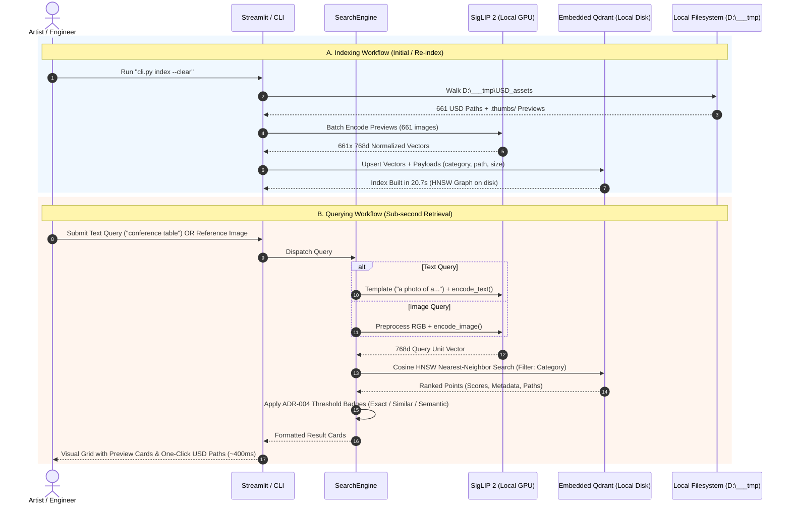
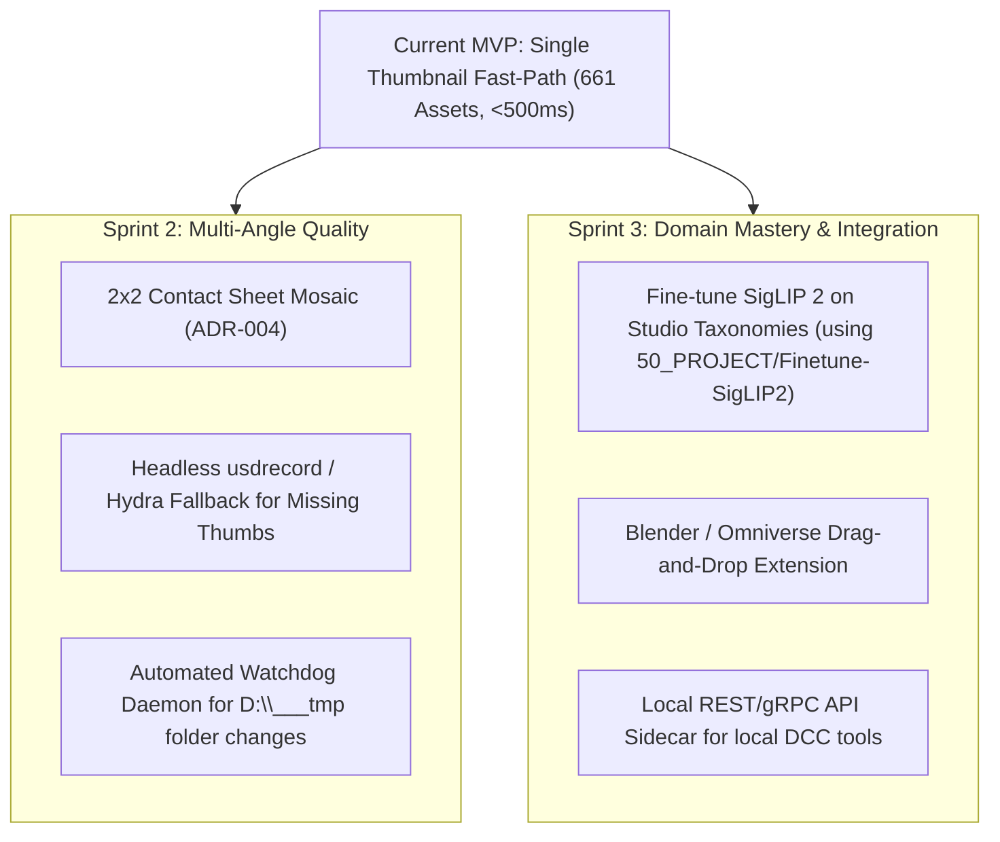

# ID-104: Local OpenUSD Multimodal Search Engine (Architecture, Operations & Roadmap)

# OVERVIEW
This comprehensive engineering report details the design, implementation, and operational workflows of **ID-104**: a 100% local, offline-capable multimodal search and retrieval engine for OpenUSD 3D asset libraries (`D:\___tmp\USD_assets`). The system leverages **Google SigLIP 2** vision-language embeddings and an **embedded Qdrant** vector database to enable sub-second text-to-3D and image-to-3D similarity searches running entirely on local workstation hardware (NVIDIA RTX 4070 Ti) with zero external cloud dependencies.

The report covers what was implemented, how the end-to-end inference and indexing pipeline functions, exact re-indexing procedures, architectural limitations identified during testing, and prioritized next steps for future sprints.

---

# 1. WHAT WAS DONE

```mermaid
graph LR
    subgraph Discovery_Phase ["1. Discovery & Specs"]
        FA["FirstApproach.md"]
        DR["DeepResearch.md"]
        SDLC["Spec-First SDLC (HLD, EIS, ADR-001..004)"]
        GAP["GapAnalysisReport.md"]
    end

    subgraph Batch_01_Delivery ["2. Batch 01 Implementation (50_PROJECT/)"]
        ENV["TASK-000: PyTorch 2.6 CUDA + Qdrant"]
        SCAN["TASK-001: AssetScanner (661 Assets Discovered)"]
        VEC["TASK-002: LocalVectorStore (Embedded Qdrant)"]
        MODEL["TASK-003: SigLIP 2 Engine & Calibration"]
        UI["TASK-004: CLI & Streamlit Dashboard"]
        TEST["TASK-005: 8/8 Pytest Suite Passing"]
    end

    Discovery_Phase --> Batch_01_Delivery
```



1. **Complete Spec-First SDLC Lifecycle**:
   - Formalized Intent, High-Level Design (HLD), Executable Implementation Specification (EIS), and 4 Architecture Decision Records (ADRs) under `wiki/_specs/`.
   - Documented the Single-Thumbnail vs. Multi-View trade-offs in `ID-104_GapAnalysisReport.md`.
2. **Environment & Hardware Bootstrap (`TASK-000`)**:
   - Initialized an isolated Python 3.12 `.venv` configured for local CUDA GPU execution on the **NVIDIA GeForce RTX 4070 Ti** (12GB VRAM).
   - Installed PyTorch `2.6.0+cu124`, Hugging Face `transformers 5.22.2`, `accelerate`, `sentencepiece`, embedded `qdrant-client 1.20.0`, and `streamlit 1.67.0`.
3. **Asset Discovery Scanner (`TASK-001`)**:
   - Authored `AssetScanner` (`50_PROJECT/src/scanner.py`), scanning `D:\___tmp\USD_assets` across Commercial, Industrial, and Residential directories.
   - Identified **661 real USD models** and resolved their corresponding pre-rendered preview images (`.thumbs/256x256/<asset>.usd.auto.png`).
4. **Embedded Local Vector Engine (`TASK-002`)**:
   - Authored `LocalVectorStore` (`50_PROJECT/src/vector_store.py`) running an in-process, zero-daemon Qdrant instance storing 768-dimensional float32 vectors directly on local NVMe disk (`50_PROJECT/data/qdrant_db/`).
5. **SigLIP 2 Inference & Query Orchestration (`TASK-003`)**:
   - Authored `SigLIP2Service` (`50_PROJECT/src/model_service.py`) loading `google/siglip2-base-patch16-224` with FP16 CUDA acceleration.
   - Fixed SigLIP 2 `padding="max_length"` prompt templating (`a photo of a ...`) and RGBA image handling.
   - Calibrated confidence threshold boundaries for both modalities in `SearchEngine` (`50_PROJECT/src/engine.py`).
6. **Dual User Interfaces (`TASK-004`)**:
   - Scriptable terminal CLI runner (`50_PROJECT/src/cli.py`) supporting `index`, `search-text`, and `search-image`.
   - Interactive local browser dashboard (`50_PROJECT/src/app.py`) built with Streamlit on `localhost:8501`.
7. **Automated Verification (`TASK-005`)**:
   - Authored test suites in `50_PROJECT/tests/` with **8/8 automated tests passing in 18s**, verifying sub-500ms query latency.

---

# 2. HOW IT WORKS

### End-to-End System Pipeline



### Core Architecture Components:
- **`50_PROJECT/src/config.py`**: Pinned constants, database paths, SigLIP 2 logit scale/bias calibration factors, and confidence thresholds.
- **`50_PROJECT/src/scanner.py`**: Deterministic UUIDv5 asset identification and recursive discovery of `.usd`, `.usda`, `.usdc` files paired with `.thumbs/256x256/*.usd.auto.png`.
- **`50_PROJECT/src/model_service.py`**: Hugging Face PyTorch module utilizing `AutoModel` + `AutoProcessor` for `google/siglip2-base-patch16-224`, generating L2-normalized 768-dim embeddings in FP16 on CUDA.
- **`50_PROJECT/src/vector_store.py`**: Local embedded Qdrant client managing HNSW collections with Cosine similarity and payload filtering (`category`, `subcategory`, `filesize`).
- **`50_PROJECT/src/engine.py`**: Query dispatcher classifying matches into Exact Match, High Similarity, and Semantic Match.

---

# 3. HOW TO RE-INDEX

When new `.usd` files are copied, modified, or added to `D:\___tmp\USD_assets`, update the local vector database using the CLI:

### Full Re-index (Recommended after adding or reorganizing folders):
Clears the existing collection and creates a clean index:
```powershell
.\.venv\Scripts\python.exe 50_PROJECT\src\cli.py index --clear
```
- **Performance**: Takes **~20 seconds** for all 661 assets on the RTX 4070 Ti.
- **Resource Footprint**: The resulting Qdrant database occupies less than **15 MB** on disk at `50_PROJECT/data/qdrant_db/`.

### Incremental / Target Re-index:
To index a specific subfolder or custom drive:
```powershell
.\.venv\Scripts\python.exe 50_PROJECT\src\cli.py index --target "D:\___tmp\USD_assets\Industrial" --batch-size 32
```

---

# 4. LIMITATIONS

1. **Single-View Perspective Bias (ADR-004)**:
   - Because the fast-path indexing reads only the pre-baked `.thumbs/256x256/*.usd.auto.png` preview, it only captures a single 3/4 isometric perspective.
   - Any geometric detail or texture on the rear, bottom, or interior of an asset (e.g., hidden engine connectors, rear cable ports, underside levers) cannot be retrieved via visual search.
2. **Thumbnail Resolution Ceiling (256x256)**:
   - Pre-rendered previews are $256\times256$ pixels. While ideal for SigLIP 2's native $224\times224$ input resolution, micro-text, small dials, or subtle screw threads may not be resolvable.
3. **Domain Vocabulary Gaps (Zero-Shot)**:
   - While general categories (`conference table`, `office chair`, `wooden crate`) retrieve top-1 matches accurately, proprietary internal CAD part codes or highly specialized mechanical jargon may require domain fine-tuning.
4. **Single-Process SQLite Locking**:
   - Embedded Qdrant runs in-process using local disk locks. Running multiple concurrent processes writing to `50_PROJECT/data/qdrant_db/` simultaneously will trigger an access lock error. (Sequential reading across the UI and CLI is fully supported).

---

# 5. POSSIBLE NEXT STEPS



1. **2x2 Contact Sheet Mosaic (Phase 2 Roadmap per ADR-004)**:
   - Render 4 turntable viewpoints ($0^\circ, 90^\circ, 180^\circ, 270^\circ$) and stitch them into a single $512\times512$ mosaic contact sheet.
   - Eliminates view-angle blind spots in a single SigLIP 2 forward pass while preserving a clean 1-to-1 vector record in Qdrant.
2. **Headless `usdrecord` Fallback Ingestion**:
   - Provide automatic offline rendering for any newly added `.usd` files that do not have pre-baked `.thumbs/` images.
3. **Automated Filesystem Watchdog**:
   - A background service using `watchdog` to monitor `D:\___tmp\USD_assets` and auto-index newly dropped USD files incrementally.
4. **SigLIP 2 Domain Fine-Tuning**:
   - Adapt the existing fine-tuning notebooks in `50_PROJECT/Finetune-SigLIP2-Image-Classification/` to specialize SigLIP 2 on custom studio CAD/USD taxonomies and materials.
5. **DCC Sidecar Integration (Blender / Omniverse Extension)**:
   - Package a lightweight Python bridge allowing artists inside Omniverse Kit or Blender to search and drag models directly onto their active 3D stages.


---

# 6. DESIGN ALIGNMENT & SPRINT 2 ROADMAP (GRILL-ME SPECIFICATION)

Following the technical alignment interview, the architecture decisions for **Sprint 2 (Batch 02)** have been formalized:

### 6.1 Strategic Focus: 360° Multi-View Contact Sheet Mosaic
- **Target Capability**: Eliminate viewpoint blind spots and perspective bias (as diagnosed in `ID-104_GapAnalysisReport.md`) by capturing $360^\circ$ visual coverage for every USD asset.
- **Rendering Toolchain**: Native **OpenUSD Python API (`pxr.Usd`, `pxr.UsdImagingGL`) and Hydra/Storm** for offscreen hardware-accelerated rasterization.
- **Mosaic Specification**:
  - Total Resolution: **$512\times512$ pixels**.
  - Layout: **2x2 Contact Sheet** containing 4 quadrants ($256\times256$ each):
    - Top-Left: Front view ($0^\circ$).
    - Top-Right: Right side view ($90^\circ$).
    - Bottom-Right: Rear view ($180^\circ$).
    - Bottom-Left: Left side view ($270^\circ$).
  - Background: Neutral studio grey (`#2B2B2B`) with default Hydra ambient lighting.
- **Ingestion & Migration Strategy**:
  - **Automatic Batch Migration**: An offline batch generation runner will process the 661 USD models in `D:\___tmp\USD_assets`, save the generated contact sheets into `.thumbs/mosaic_512/`, compute the holistic SigLIP 2 vectors, and replace the database index while preserving clean 1-to-1 vector points in Qdrant.
