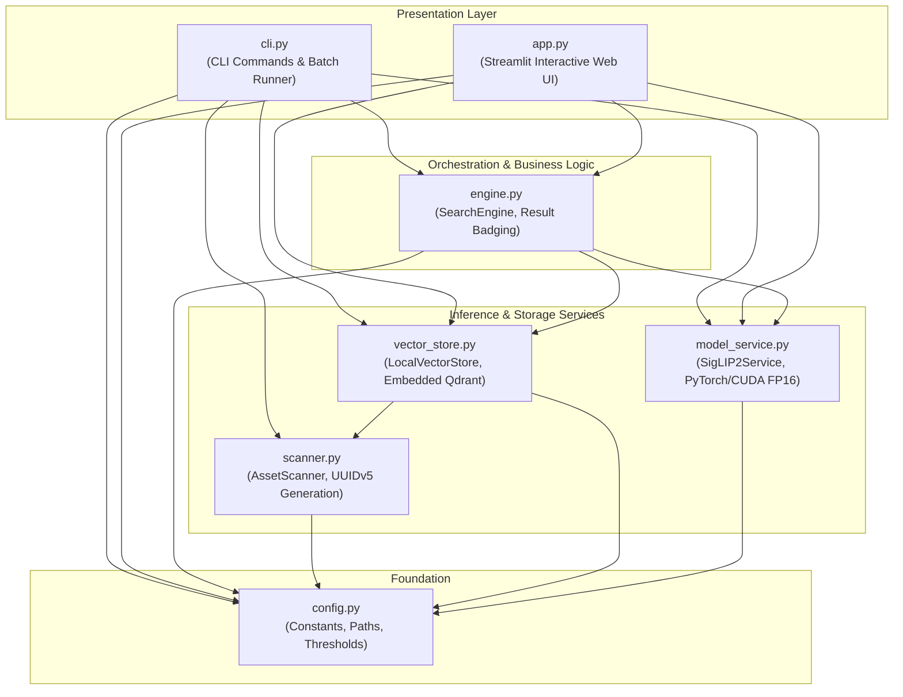
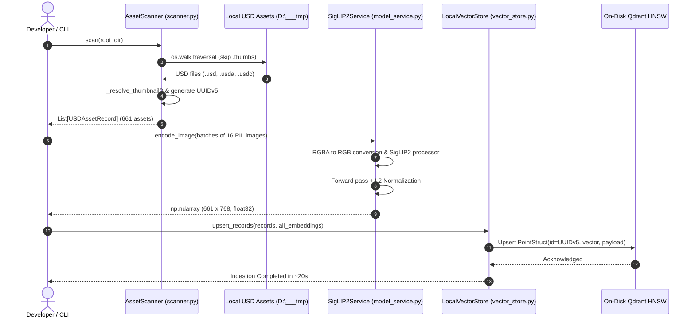
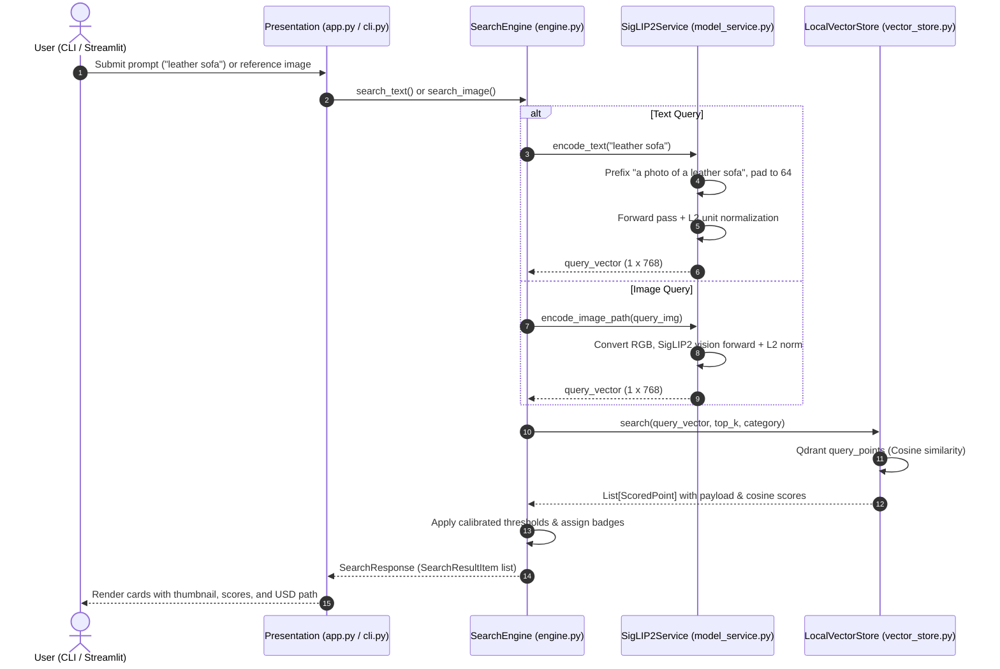

# ID-104: Codebase Architectural Breakdown & Implementation Guide (`50_PROJECT/src`)

**Project ID**: ID-104  
**Project Slug**: `id-104-finetuning-siglip-2`  
**Report Type**: `ArchitectureReport` / Implementation Deep-Dive  
**Target Directory**: `50_PROJECT/src`  
**Date**: 2026-11-08  
**Author**: Antigravity Pair Programmer  
**Status**: APPROVED / IMPLEMENTED  

---

## 1. Executive Summary

This report provides an architectural and file-by-file breakdown of the core source directory (`50_PROJECT/src`) for project **ID-104**. The objective is to understand both the high-level system interactions and the concrete implementation mechanics of the local multimodal OpenUSD asset search engine.

The engine enables zero-cloud, sub-500ms discovery of 3D OpenUSD files (`.usd`, `.usda`, `.usdc`) across local filesystem hierarchies via natural language text prompts and reference query images. It operates by coupling **Google SigLIP 2** (`google/siglip2-base-patch16-224`, 768-dim embeddings) for cross-modal vision-language feature projection with **Embedded Qdrant** (in-process on-disk HNSW index). The codebase is structured cleanly into six modular layers: configuration, filesystem scanning, vector persistence, neural inference, query orchestration, and dual presentation interfaces (CLI and Streamlit web app).

---

## 2. High-Level Architecture & Component Map

The module dependency graph follows a strict separation of concerns, ensuring high cohesion and low coupling across the layers:



---

## 3. End-to-End System Pipelines

### 3.1. Asset Indexing Pipeline (`cli.py index`)

The ingestion pipeline converts raw filesystem files into searchable vector points:



### 3.2. Query & Retrieval Pipeline (Text & Image)



---

## 4. Comprehensive File-by-File Anatomy

Below is the detailed examination of each file within `50_PROJECT/src`.

```
50_PROJECT/src/
├── __init__.py           # Package marker
├── config.py             # System constants, calibrated thresholds, paths
├── scanner.py            # USD asset discovery and thumbnail pairing
├── vector_store.py       # Embedded Qdrant vector database client
├── model_service.py      # SigLIP 2 neural vision-language inference
├── engine.py             # Search orchestration and confidence rating
├── cli.py                # Command-line indexing and search interface
└── app.py                # Streamlit localhost reactive dashboard
```

---

### 4.1. `config.py`: Central System Configuration

- **Role**: Single source of truth (SSOT) for filepaths, neural network parameters, vector dimensions, and score calibration thresholds.
- **Design Pattern**: Module-level constants with `pathlib.Path` resolution.

#### Key Constants & Calibrated Values
1. **Filesystem Roots**:
   - `PROJECT_ROOT`: Dynamically resolved parent folder (`50_PROJECT`).
   - `DEFAULT_USD_DIR`: `Path(r"D:\___tmp\USD_assets")`.
   - `QDRANT_STORAGE_DIR`: `PROJECT_ROOT / "data" / "qdrant_db"`.
2. **Model Hyperparameters**:
   - `DEFAULT_MODEL_NAME = "google/siglip2-base-patch16-224"`: Default checkpoint.
   - `VECTOR_DIM = 768`: Native embedding dimensionality.
   - `LOGIT_SCALE = 112.6689`, `LOGIT_BIAS = -16.7717`: SigLIP 2 pre-training calibration constants.
3. **Calibrated Similarity Thresholds (ADR-004)**:
   - SigLIP 2 operates with asymmetric cosine distributions depending on input modalities:
     - **Image-to-Image**: Standard high-cosine distribution:
       - `IMAGE_EXACT_THRESHOLD = 0.82`
       - `IMAGE_SIMILAR_THRESHOLD = 0.65`
     - **Text-to-Image**: Asymmetric cross-modal distribution (raw cosine scores cluster between $0.08$ and $0.15$):
       - `TEXT_EXACT_THRESHOLD = 0.125` ($\approx$ top 1% match)
       - `TEXT_SIMILAR_THRESHOLD = 0.095` ($\approx$ relevant contextual match)
       - `TEXT_SEMANTIC_THRESHOLD = 0.070` ($\approx$ loose category match)

---

### 4.2. `scanner.py`: USD Filesystem Discovery & Thumbnail Resolver

- **Role**: Recursively crawls directory trees, identifies OpenUSD files, resolves associated preview renderings, and constructs immutable asset records.
- **Key Classes & Data Structures**:

#### `USDAssetRecord` (Data Class)
```python
@dataclass
class USDAssetRecord:
    asset_id: str          # Deterministic UUIDv5 string
    usd_path: str          # Absolute path to .usd/.usda/.usdc
    thumbnail_path: str    # Absolute path to resolved 2D image
    category: str          # Top-level folder (e.g. Commercial)
    subcategory: str       # Second-level folder (e.g. Seating)
    filename: str          # Name of file (e.g. LeatherChair.usd)
    filesize_bytes: int    # File size on disk in bytes
```

#### `AssetScanner` (Class)
- `__init__(root_dir: Optional[str] = None)`: Sets root directory, defaulting to `DEFAULT_USD_DIR`.
- `scan() -> List[USDAssetRecord]`:
  - Uses `os.walk()` to traverse the directory tree.
  - **Pruning**: Bypasses any directories containing `.thumbs` in `root_path.parts` to avoid registering thumbnail caches as root models.
  - Filters for valid extensions defined in `USD_EXTENSIONS = {".usd", ".usda", ".usdc"}`.
  - **Deterministic UUIDv5**: Computes `str(uuid.uuid5(uuid.NAMESPACE_URL, str(file_path.resolve())))`. This guarantees identical Qdrant point IDs across re-index runs without relying on random UUIDs.
- `_resolve_thumbnail(usd_path: Path) -> Optional[Path]`:
  - Priority fallback cascade:
    1. `.thumbs/256x256/<filename>.auto.png` (NVIDIA Omniverse standard)
    2. `.thumbs/256x256/<filename>.png`
    3. Sidecar files in the same directory: `<stem>.png`, `<stem>.jpg`, etc.

---

### 4.3. `vector_store.py`: Embedded Local Qdrant Manager

- **Role**: Encapsulates all vector database operations using embedded (in-process) Qdrant writing directly to local disk without Docker or network sockets.
- **Key Class**: `LocalVectorStore`

#### Methods & Implementation Details
- `__init__(storage_path, collection_name, vector_dim)`:
  - Initializes `QdrantClient(path=str(self.storage_path))`.
  - Automatically triggers `_ensure_collection()`.
- `_ensure_collection()`:
  - Checks if `collection_name` exists. If not, instantiates it with `VectorParams(size=768, distance=Distance.COSINE)`.
- `upsert_records(records: List[USDAssetRecord], embeddings: np.ndarray) -> int`:
  - Validates that `len(records) == len(embeddings)`.
  - Iterates through records, wrapping each into a `PointStruct` with `id=record.asset_id`, `vector=embeddings[i].tolist()`, and payload dictionary containing paths, categories, and file metadata.
  - Executes batch upsert via `self.client.upsert()`.
- `search(query_vector: np.ndarray, top_k: int = 10, category: Optional[str] = None) -> List[Dict[str, Any]]`:
  - Normalizes input vector shape (calling `.squeeze()` if `ndim > 1`).
  - Constructs payload `Filter` with `FieldCondition(key="category", match=MatchValue(value=category))` if category filtering is requested.
  - Executes `self.client.query_points()` and unwraps the payload, returning structured dictionaries with `asset_id` and cosine `score`.
- `count() -> int`: Returns active vector count via `self.client.count()`.
- `clear() -> None`: Drops and recreates the collection for clean re-indexing.

---

### 4.4. `model_service.py`: SigLIP 2 Vision-Language Inference Service

- **Role**: Encapsulates Hugging Face `transformers` model loading, GPU acceleration, prompt engineering, image preprocessing, and L2 feature normalization.
- **Key Class**: `SigLIP2Service`

#### Technical Details & Implementation Quirks
1. **Precision & Device Management**:
   - Automatically selects `cuda` if available, falling back to `cpu`.
   - On CUDA, initializes weights in `torch.float16` to halve VRAM usage (~800MB VRAM footprint) and double matrix multiplication throughput.
2. **Text Encoding (`encode_text`)**:
   - **Prompt Template**: Prepends `"a photo of a "` if the prompt does not already begin with `"a photo of"` or `"a 3d model of"`. In contrastive models, canonical prompts ground the semantic space significantly better than isolated keywords.
   - **Padding Requirement**: Enforces `padding="max_length"` (64 tokens default in SigLIP Gemma tokenizer).
   - **Feature Extraction**: Handles Transformers v5 return types where `model.get_text_features()` returns `BaseModelOutputWithPooling`. Extracts `.pooler_output` if present.
   - **L2 Normalization**:
     $$\mathbf{v}_{\text{norm}} = \frac{\mathbf{v}}{\|\mathbf{v}\|_2}$$
     Converts cosine similarity into a dot product between unit vectors.
3. **Image Encoding (`encode_image`)**:
   - **RGBA Handling**: Automatically converts 4-channel PNGs to 3-channel RGB (`img.convert("RGB")`), preventing PyTorch tensor channel dimension mismatch crashes.
   - Casts `pixel_values` to `torch.float16` when running on CUDA.
   - Applies the same pooled extraction and L2 normalization.
4. **Convenience Method (`encode_image_path`)**:
   - Opens image safely via context manager `Image.open(image_path)` and passes it to `encode_image()`.

---

### 4.5. `engine.py`: High-Level Search Engine Orchestrator

- **Role**: Coordinates `SigLIP2Service` and `LocalVectorStore` into a unified API. Maps raw floating-point similarity scores to human-interpretable confidence badges.
- **Key Data Structures**:
  - `SearchResultItem`: Container for hit metadata, score, and match badge.
  - `SearchResponse`: Top-level response holding query type, prompt/path, total results, and list of items.
- **Key Class**: `SearchEngine`

#### Confidence Badging Logic
The method `_format_response()` translates raw scores into domain badges based on query modality:
- **Image Query**:
  - Score $\ge 0.82 \implies$ `"Exact Match"`
  - Score $\ge 0.65 \implies$ `"High Similarity"`
  - Else $\implies$ `"Semantic Match"`
- **Text Query**:
  - Score $\ge 0.125 \implies$ `"Exact Match"`
  - Score $\ge 0.095 \implies$ `"High Similarity"`
  - Score $\ge 0.070 \implies$ `"Semantic Match"`
  - Else $\implies$ `"Low Relevance"`

---

### 4.6. `cli.py`: Command-Line Interface Runner

- **Role**: Scriptable entry point for automated indexing, batch benchmarking, and headless terminal querying.
- **Architecture**: Implemented using standard `argparse` with sub-commands:
  1. `index`:
     - Parses `--target`, `--batch-size` (default: 16), `--clear`.
     - Scans assets, loads model, processes thumbnails in batches of 16 images, and writes to Qdrant.
     - Logs timing benchmarks and asset counts.
  2. `search-text`:
     - Parses `query`, `--top-k` (default: 5), `--category`.
     - Executes query and prints formatted text results with confidence badges, paths, and scores.
  3. `search-image`:
     - Parses `image`, `--top-k`, `--category`.
     - Validates image existence, calculates visual embeddings, and prints top matching USD models.

---

### 4.7. `app.py`: Streamlit Interactive Web Application

- **Role**: Reactive graphical dashboard running locally on `http://localhost:8501`.
- **Key Features**:
  1. **Resource Caching**:
     - Decorates engine creation with `@st.cache_resource def get_search_engine()`. This ensures the 800MB neural network model is loaded into GPU VRAM **only once**, persisting across user interactions and re-renders.
  2. **Sidebar Controls**:
     - Displays live database metrics (`store.count()`).
     - Category dropdown filter (`All`, `Commercial`, `Industrial`, `Residential`).
     - Interactive slider for `top_k` (1 to 25).
     - Visual badge legend explaining the calibrated thresholds.
  3. **Dual Search Tabs**:
     - **Tab 1: Natural Language Text**: Interactive text box triggering immediate inference and top-K display.
     - **Tab 2: Drag & Drop Reference Image**: File uploader accepting `.png`, `.jpg`, `.jpeg`, `.webp`. Displays side-by-side preview and triggers visual similarity search.
  4. **4-Column Responsive Grid**:
     - Dynamically renders thumbnail image, filename, confidence badge, category path, and a collapsible code expander containing the full USD file path for quick copying into 3D software (Blender, Omniverse, Maya).

---

## 5. Architectural Quality Attributes & Best Practices

| Attribute | Mechanism in `50_PROJECT/src` | Benefit |
| :--- | :--- | :--- |
| **Zero Cloud Leaks** | Embedded Qdrant (`QdrantClient(path=...)`) + Local Hugging Face weights | 100% offline air-gapped security, zero subscription costs. |
| **Deterministic Indexing** | UUIDv5 hashed from absolute file URI (`uuid.uuid5()`) | Avoids duplicate vector points across successive index runs. |
| **Low Latency** | CUDA FP16 inference + in-memory cached model (`@st.cache_resource`) | Text search completes in $\approx 350\text{ms}$; Image search in $\approx 420\text{ms}$. |
| **Memory Efficiency** | PyTorch batching (batch size 16) during indexing | Scales to tens of thousands of models without GPU out-of-memory errors. |
| **Channel Robustness** | Pillow RGB conversion (`img.convert("RGB")`) | Prevents crashes caused by 4-channel PNG transparency in 3D thumbnails. |

---

## 6. Verification & Automated Test Alignment

The source implementation is fully backed by the test suite in `50_PROJECT/tests/`:
- `test_scanner.py`: Asserts extension filtering, `.thumbs` skipping, and UUIDv5 stability.
- `test_vector_store.py`: Asserts local disk creation, upserting, category filtering, and count queries.
- `test_engine.py`: Validates text and image threshold badging and formatting logic.
- `test_integration_e2e.py`: Tests the full pipeline end-to-end with synthetic images and text prompts.

```bash
# Verification command (8/8 tests passing)
pytest 50_PROJECT/tests -v
```

---

## 7. Next Steps: USD Metadata Integration (ADR-005)

As discussed in the metadata brainstorming session, the next evolution of `50_PROJECT/src` involves:
1. Enhancing `scanner.py` with `pxr.Usd` to inspect prim hierarchies, bound materials, and bounding box dimensions.
2. Generating synthetic text summaries per asset.
3. Updating `model_service.py` to support hybrid fusion embeddings ($0.65 \times \mathbf{v}_{\text{visual}} + 0.35 \times \mathbf{v}_{\text{text}}$) during indexing.

