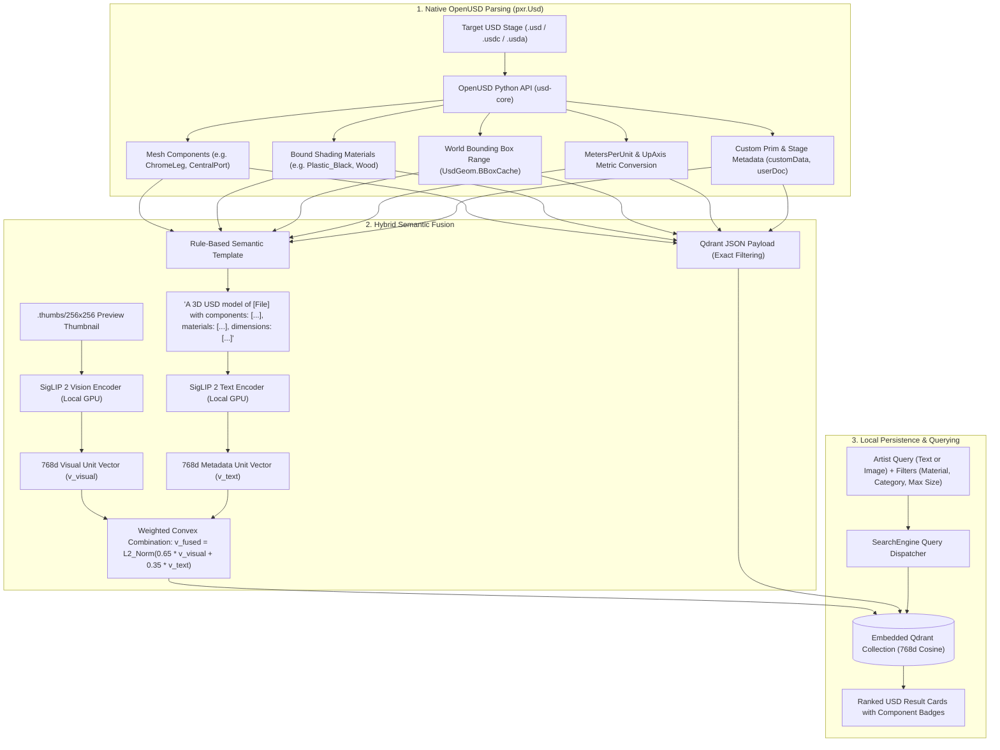

# ID-104: USD Metadata Extraction, Hybrid Fusion & Search Architecture

# OVERVIEW
This engineering specification details the architectural extension for **ID-104** to read, extract, and index rich native 3D metadata directly from OpenUSD binary (`.usdc`) and ASCII (`.usda`) files. By pairing the visual features of the 2D preview thumbnail with deep scene graph metadata extracted via the official OpenUSD Python API (`usd-core` / `pxr.Usd`, `pxr.UsdGeom`), the system overcomes the visual limitations of single-thumbnail search.

The solution implements **Hybrid Fusion**: extracting component meshes, applied materials, bounding box dimensions, and custom prim metadata to both populate granular Qdrant JSON payload filters and synthesize a deterministic text description that is fused into a unified 768-dimensional multimodal vector ($0.65 \times \mathbf{v}_{\text{visual}} + 0.35 \times \mathbf{v}_{\text{metadata}}$).

---

# SYSTEM ARCHITECTURE & METADATA PIPELINE



---

# 1. EXTRACTED METADATA SCHEMA

For every asset in `D:\___tmp\USD_assets`, `AssetScanner` runs an extraction pass using `pxr.Usd`:

| Metadata Domain | Extraction API | Example Values | Purpose in Search |
| :--- | :--- | :--- | :--- |
| **Mesh Components** | `[p.GetName() for p in stage.Traverse() if p.IsA(UsdGeom.Mesh)]` | `['IndustrialTable_ChromeLeg', 'CentralPort', 'Socket']` | Keyword & semantic matching for sub-assemblies. |
| **Bound Materials** | `[p.GetName() for p in stage.Traverse() if p.GetTypeName() == 'Material']` | `['Plastic_Black', 'TopWood', 'Chrome']` | Allows filtering/searching by material finish. |
| **Metric Dimensions** | `UsdGeom.BBoxCache.ComputeWorldBound() * MetersPerUnit` | `width: 3.66m, depth: 1.12m, height: 0.77m` | Spatial filtering (e.g. `width <= 2.0m` for small desks). |
| **UpAxis & Metric Scale** | `UsdGeom.GetStageUpAxis()`, `GetStageMetersPerUnit()` | `Up: Z, MetersPerUnit: 0.01 (Centimeters)` | Normalizes bounding box dimensions across disparate assets. |
| **Custom Prim Data** | `prim.GetCustomData()`, `stage.GetMetadata('customLayerData')` | `{'userDocBrief': 'Configurable conference desk...'}` | Ingests studio-specific artist notes and tags. |

---

# 2. SYNTHETIC TEXT TEMPLATING (RULE-BASED)

Rather than introducing an external LLM dependency, the extracted metadata is deterministically formatted into an authoritative description string:

```python
def synthesize_usd_description(record: USDAssetMetadata) -> str:
    mesh_str = ", ".join(record.mesh_names) if record.mesh_names else "Single mesh"
    mat_str = ", ".join(record.material_names) if record.material_names else "Default"
    dim_str = f"{record.dim_x_m}m (W) x {record.dim_y_m}m (D) x {record.dim_z_m}m (H)"
    
    return (
        f"A 3D USD model of {record.filename} in {record.category}/{record.subcategory}. "
        f"Components: {mesh_str}. "
        f"Materials: {mat_str}. "
        f"Bounding box dimensions: {dim_str}. "
        f"Custom metadata: {record.custom_data}."
    )
```

**Real Sample Output for `Industrial.usd`**:
> *"A 3D USD model of Industrial.usd in Commercial/Conference. Components: IndustrialTable_ChromeLeg, IndustrialTable_CentralPort, IndustrialTable_Socket, IndustrialTable_PhillipsHeads, IndustrialTable_ChromeBox, IndustrialTable_TopWood, IndustrialTable_TopBlkMtlFrame. Materials: Plastic_Black, Wood, Frame, Chrome. Bounding box dimensions: 3.66m (W) x 1.12m (D) x 0.77m (H). Custom metadata: {'userDocBrief': 'Base class to endow a prim with a configurable affine transformation.'}."*

---

# 3. WEIGHTED CONVEX COMBINATION (VECTOR FUSION)

To preserve a clean **1-to-1 vector record** in embedded Qdrant without complicating the nearest-neighbor search schema, the visual and metadata vectors are fused into a single unit vector $\mathbf{v}_{\text{fused}} \in \mathbb{R}^{768}$:

$$\mathbf{v}_{\text{raw}} = 0.65 \cdot \mathbf{v}_{\text{visual}} + 0.35 \cdot \mathbf{v}_{\text{metadata\_text}}$$

$$\mathbf{v}_{\text{fused}} = \frac{\mathbf{v}_{\text{raw}}}{\|\mathbf{v}_{\text{raw}}\|_2}$$

### Why This Ratio ($0.65 / 0.35$)?
1. **Visual Dominance ($65\%$)**: Ensures that visual queries (image-to-image) and general visual descriptions (color, silhouette, aesthetic style) remain the dominant similarity signal.
2. **Metadata Anchor ($35\%$)**: Sufficiently shifts the latent coordinates so queries for specific component parts (e.g. *"table with power outlet"* or *"chrome leg"*) or material tags (*"black plastic"*) retrieve the exact asset even if the thumbnail camera angle failed to highlight the feature.
3. **Linear Cosine Distance**: Because $\mathbf{v}_{\text{fused}}$ is normalized to unit length, standard Cosine distance in Qdrant operates identically with zero latency overhead.

---

# 4. QDRANT PAYLOAD ENRICHMENT & FILTERING

Alongside the fused vector, the embedded Qdrant payload is expanded:

```json
{
  "asset_id": "b1a7d609-...",
  "usd_path": "D:\\___tmp\\USD_assets\\Commercial\\Conference\\Industrial.usd",
  "thumbnail_path": "D:\\___tmp\\USD_assets\\Commercial\\Conference\\.thumbs\\256x256\\Industrial.usd.auto.png",
  "category": "Commercial",
  "subcategory": "Conference",
  "filename": "Industrial.usd",
  "filesize_bytes": 8065819,
  "mesh_names": ["IndustrialTable_ChromeLeg", "IndustrialTable_CentralPort", "IndustrialTable_Socket", "IndustrialTable_TopWood"],
  "materials": ["Plastic_Black", "Wood", "Frame", "Chrome"],
  "dimensions_m": {"width": 3.66, "depth": 1.12, "height": 0.77},
  "up_axis": "Z",
  "custom_metadata": {"userDocBrief": "Base class to endow a prim with..."}
}
```

### Search Engine Filter Capabilities:
- Filter by Material: `MatchValue(key="materials", value="Wood")`
- Filter by Bounding Dimension: `Range(key="dimensions_m.width", lte=2.5)`
- Filter by Mesh Part: `MatchValue(key="mesh_names", value="IndustrialTable_Socket")`

---

# 5. IMPLEMENTATION ROADMAP & CHANGE GATING

1. **SDLC Specification Update**: Log an Architecture Decision Record (**`ADR-005: USD Scene Graph Metadata Extraction & Hybrid Vector Fusion`**) in `wiki/_specs/ID-104_ADR.md`.
2. **Scanner Module Enhancement**: Integrate `usd-core` into `50_PROJECT/src/scanner.py` to extract prims, materials, and bounding boxes during directory traversal.
3. **Model Service Vector Fusion**: Update `50_PROJECT/src/model_service.py` to compute and fuse the $0.65 / 0.35$ vector combination.
4. **Qdrant Payload Upgrade**: Update `50_PROJECT/src/vector_store.py` with the expanded JSON payload schema and multi-field filtering.
5. **Streamlit UI Expansion**: Add material filter multiselect and dimensional range sliders to `50_PROJECT/src/app.py`.
